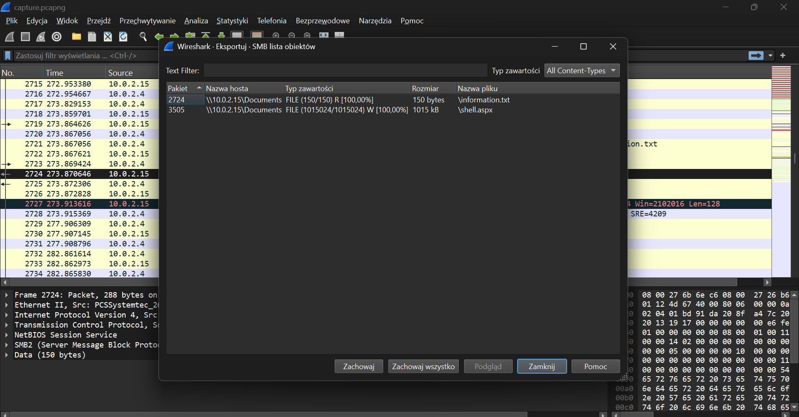

#  DFIR Case Study: Analiza Powłamaniowa Serwera IIS, Memory Forensics & Klasyfikacja AgentTesla (Scenariusz „Lockdown”)


---

##  1. Streszczenie Zarządcze (Executive Summary)

Niniejszy dokument stanowi techniczny raport z analizy powłamaniowej (Incident Response & Digital Forensics) przeprowadzonej po wykryciu podejrzanej aktywności na firmowym serwerze webowym opartym o usługę **Microsoft IIS**. 

W toku dochodzenia przeanalizowano przechwycony ruch sieciowy (`.pcap`), zrzut pamięci operacyjnej RAM (`.mem`) oraz wyekstrahowane artefakty wykonywalne. Śledztwo wykazało, że atakujący wykorzystał podatność w aplikacji webowej do uzyskania zdalnego wykonania kodu (RCE) w kontekście procesu roboczego IIS (`w3wp.exe`), zestawił połączenie zwrotne (Reverse Shell), a następnie wdrożył mechanizm utrzymania dostępu (Persistence) w katalogu autostartu systemu Windows. Analiza statyczna oraz korelacja z bazami Threat Intelligence pozwoliły zidentyfikować ładunek końcowy jako zmodyfikowany wariant trojana/infostealera z rodziny **AgentTesla**, dodatkowo zabezpieczony przed analizą pakerem **UPX**.

---

##  2. Środowisko Analityczne i Narzędzia

* **Analiza sieciowa (Network Forensics):** Wireshark
* **Analiza pamięci RAM (Memory Forensics):** Volatility 3 Framework (środowisko WSL2 Ubuntu)
* **Analiza statyczna złośliwego oprogramowania:** Pestudio, PE-bear, FLOSS, UPX, `strings`, `sha256sum` (FLARE VM / Linux)
* **Threat Intelligence & Sandbox:** VirusTotal, MITRE ATT&CK Framework

---

##  3. Mapowanie MITRE ATT&CK

| Taktyka (Tactic) | Technika (Technique) | ID | Zaobserwowana aktywność w incydencie |
| :--- | :--- | :--- | :--- |
| **Initial Access / Execution** | Exploit Public-Facing Application | `T1190` | Wykorzystanie usługi webowej i wykonanie kodu przez proces `w3wp.exe`. |
| **Persistence** | Boot or Logon Autostart Execution: Registry Run Keys / Startup Folder | `T1547.001` | Umieszczenie implantu `updatenow.exe` w globalnym folderze `StartUp`. |
| **Defense Evasion** | Obfuscated Files or Information: Software Packing | `T1027.002` | Spakowanie pliku wykonywalnego pakerem `UPX` w celu ukrycia ciągów znaków i IAT. |
| **Command and Control** | Application Layer Protocol: Web Protocols | `T1071.001` | Komunikacja typu *beaconing* ze zdalnym serwerem C2 po nazwie FQDN. |

---

##  4. Przebieg Śledztwa (Step-by-Step Investigation)

### Etap I: Analiza Ruchu Sieciowego (Network Forensics – PCAP)

Pierwsza faza śledztwa obejmowała analizę zapisu komunikacji sieciowej w programie **Wireshark** w celu identyfikacji wektora początkowego, skanowania oraz pobranych ładunków (stager/dropper).

* **Identyfikacja podejrzanego ruchu i adresacji:**
  * Adres IP atakującego / źródło ataku: `10.0.2.4`
  * Wykorzystany port komunikacji: `4443`
* **Rekonstrukcja przesyłanych obiektów:**
  Za pomocą funkcji `File -> Export Objects -> HTTP` oraz filtrów warstwy aplikacji (`http.request.method == "GET"`) zidentyfikowano pobrany złośliwy plik:
  * Nazwa pobranego pliku / skryptu: `shell.aspx`

 

---

### Etap II: Analiza Pamięci Operacyjnej (Memory Forensics – Volatility 3)

W celu zbadania stanu systemu w momencie incydentu przeprowadzono analizę surowego zrzutu pamięci `memdump.mem`.

#### 1. Identyfikacja parametrów jądra systemu (Q6)
W pierwszej kolejności zweryfikowano profil pamięci oraz adres bazowy jądra (`ntoskrnl.exe`) za pomocą wtyczki `windows.info`:

```bash
vol -f memdump.mem windows.info
```

* **Ustalenie (Q6 – Kernel Base Address):** `0xf80079213000`

#### 2. Analiza drzewa procesów i wykrycie anomalii IIS (Q7 & Q8)
Wykorzystano wtyczkę `windows.pstree` oraz `windows.cmdline` do rekonstrukcji relacji rodzic–potomek (PPID -> PID) wśród procesów uruchomionych w systemie:

```bash
vol -f memdump.mem windows.pstree
vol -f memdump.mem windows.cmdline | grep -i "\.exe"
```

W gałęzi usługi serwera webowego IIS (`svchost.exe -k iissvcs`, PID: `2452`) zidentyfikowano proces roboczy **`w3wp.exe`** (PID: **`4332`**), który powołał do życia niestandardowy proces potomny spoza stosu IIS:

```text
**   2452  628   svchost.exe   ... -k iissvcs
***  4332  2452  w3wp.exe      ... \Windows\System32\inetsrv\w3wp.exe
****  900  4332  updatenow.exe ... C:\ProgramData\Microsoft\Windows\Start Menu\Programs\StartUp\updatenow.exe
```

* **Ustalenie (Q7 – Pełna ścieżka implantu na dysku):** `C:\ProgramData\Microsoft\Windows\Start Menu\Programs\StartUp\updatenow.exe`
* **Ustalenie (Q8 – Proces nadrzędny obsługujący połączenie i jego PID):** `w3wp.exe, 4332` (PID implantu `updatenow.exe`: `900`)

### Etap III: Statyczna Analiza Malware i Threat Intelligence

W celu zbadania funkcjonalności pliku `updatenow.exe` (PID: `900`) wyekstrahowano obraz procesu z pamięci RAM i poddano go analizie statycznej.

```bash
vol -f memdump.mem windows.dumpfiles --pid 900
sha256sum updatenow.exe
```

#### 1. Weryfikacja obfuskacji i pakerów (Q9)
Badanie nagłówka PE oraz sekcji pliku w narzędziach **Pestudio oraz PE-bear** wykazało podwyższoną entropię oraz sekcje wskazujące na zastosowanie kompresji wykonywalnej utrudniającej statyczną ekstrakcję ciągów znaków.

* **Ustalenie (Q9 – Zastosowany paker):** `UPX`

#### 2. Analiza Threat Intelligence i komunikacji C2 (Q10 & Q11)
Obliczony skrót kryptograficzny SHA256 próbki skorelowano z raportami z piaskownic (Sandbox) oraz bazą **VirusTotal**:

* **SHA256 próbki:** `c25a6673a24d169de1bb399d226c12cdc666e0fa534149fc9fa7896ee61d406f`
* **Ustalenie (Q10 – Kontaktowana domena C2 / FQDN):** `cp8nl.hyperhost.ua`
* **Ustalenie (Q11 – Klasyfikacja rodziny malware):** `AgentTesla`

##  5. Wskaźniki Kompromitacji (Indicators of Compromise – IoC)

| Typ IoC | Wartość | Kontekst / Opis |
| :--- | :--- | :--- |
| Ścieżka pliku | C:\ProgramData\Microsoft\Windows\Start Menu\Programs\StartUp\updatenow.exe | Lokalizacja implantu zapewniająca autostart (Persistence) |
| Proces nadrzędny | w3wp.exe (PID: 4332) | Proces IIS wykorzystany do uruchomienia ładunku |
| SHA256 | c25a6673a24d169de1bb399d226c12cdc666e0fa534149fc9fa7896ee61d406f | Skrót kryptograficzny zrzuconego pliku updatenow.exe |
| Domena (FQDN) | cp8nl.hyperhost.ua | Serwer Command and Control (C2) odbierający dane z beacona |
| Adres IP | 10.0.2.4 | Adres IP powiązany z aktywnością sieciową atakującego |

##  6. Rekomendacje Poincydentalne (Remediation & Hardening)

1. **Izolacja i usunięcie perzystencji:** Natychmiastowe odcięcie zainfekowanego hosta od sieci produkcyjnej, zakończenie drzewa procesów `w3wp.exe` (PID 4332) -> `updatenow.exe` (PID 900) oraz usunięcie złośliwego pliku z katalogu `C:\ProgramData\Microsoft\Windows\Start Menu\Programs\StartUp\`.
2. **Blokada na poziomie sieciowym (Firewall / DNS Sinkhole):** Zablokowanie ruchu wychodzącego do zidentyfikowanej domeny C2 oraz powiązanych adresów IP.
3. **Utwardzenie serwera IIS (Hardening):**
   * Przegląd logów IIS pod kątem wgranych skryptów typu Web Shell (`.aspx`, `.ashx`).
   * Wdrożenie reguł **ASR (Attack Surface Reduction)** oraz monitoringu **Sysmon (Event ID 1)** alarmujących o każdym przypadku, w którym proces `w3wp.exe` uruchamia procesy potomne (`cmd.exe`, `powershell.exe` lub binarki z katalogów `ProgramData` / `Users`).
4. **Rotacja poświadczeń:** Ze względu na specyfikę działania infostealera **AgentTesla** (kradzież danych uwierzytelniających z przeglądarek, klientów pocztowych i schowka), konieczne jest unieważnienie aktywnych sesji oraz wymuszenie zmiany haseł dla wszystkich kont obecnych na serwerze.

##  Napotkane Problemy i Sposób Ich Rozwiązania (Troubleshooting & Lessons Learned)

Podczas realizacji laboratorium napotkano szereg wyzwań środowiskowych oraz analitycznych:

1. **Izolacja środowiska WSL2 i translacja ścieżek Windows-Linux:**
   * *Problem:* Próba bezpośredniego odwołania się do pliku pamięci z poziomu Linuksa przy użyciu notacji Windowsowej (`C:\Users\...` oraz ukośników `\`) powodowała błędy `File does not exist` z powodu interpretacji ukośnika jako znaku ucieczki w powłoce Bash.
   * *Rozwiązanie:* Zastosowano poprawną translację punktu montowania dysków Windows w WSL (`/mnt/c/Users/.../memdump.mem`) oraz przeniesiono pliki do natywnego systemu plików Linuksa (`~/`), co znacznie skróciło czas parsowania struktur pamięci.

2. **Ograniczenia środowiska Python (PEP 668) i brak bibliotek C:**
   * *Problem:* Nowe mechanizmy ochrony systemowych pakietów Pythona blokowały instalację zależności Volatility 3 (`externally-managed-environment`), a instalacja biblioteki `yara-python` przerywała się z powodu braku kompilatora C (`gcc`).
   * *Rozwiązanie:* Zastosowano flagę `--break-system-packages` dla bezpiecznego środowiska laboratoryjnego oraz uruchomiono analizę z wykorzystaniem wbudowanych wtyczek `pslist`/`pstree`, które nie wymagają zewnętrznego modułu kompilacji reguł YARA.

3. **Utrudniona analiza statyczna spowodowana pakowaniem UPX (Defense Evasion):**
   * *Problem:* Próby odczytania konfiguracji i domen C2 bezpośrednio z wyekstrahowanego pliku narzędziem `floss` i `strings` nie zwracały czytelnych adresów FQDN.
   * *Rozwiązanie:* Inspekcja nagłówka PE w Detect It Easy (DiE) ujawniła obecność sekcji `UPX0`/`UPX1`. Zamiast polegać na surowych ciągach, obliczono unikalny skrót SHA256 pliku i przeprowadzono korelację z bazami Threat Intelligence (VirusTotal / Hybrid Analysis), uzyskując pełną telemetrię połączeń C2 rodziny AgentTesla[cite: 12].

---

##  Wnioski Końcowe 

* **Relacja procesów kluczem do detekcji:** Analiza zrzutu pamięci potwierdziła, że procesy webowe (takie jak `w3wp.exe`) nigdy nie powinny być rodzicami dla plików wykonywalnych w lokalizacjach autostartu (`StartUp`). Jest to silny wskaźnik anomalii, który w środowisku produkcyjnym pozwala na błyskawiczne podniesienie priorytetu alertu w SIEM/EDR.
* **Wielowarstwowa analiza dowodowa:** Samo badanie sieci (PCAP) lub samej pamięci (RAM) daje wybiórczy obraz incydentu. Dopiero połączenie analizy sieciowej (identyfikacja wektora początkowego i komunikacji zwrotnej), analizy pamięci (odtworzenie drzewa procesów w Volatility) oraz inżynierii wstecznej (atrybucja malware) pozwoliło na zrekonstruowanie pełnego łańcucha Cyber Kill Chain.

##  7. Zweryfikowane Źródła i Dokumentacja

* **MITRE ATT&CK – Agent Tesla (S0331):** https://attack.mitre.org/software/S0331/
* **MITRE ATT&CK – Boot or Logon Autostart Execution (T1547.001):** https://attack.mitre.org/techniques/T1547/001/
* **Volatility 3 Official Documentation:** https://volatility3.readthedocs.io/
* **Wireshark User's Guide – Exporting Objects:** https://www.wireshark.org/docs/wsug_html_chunked/ChIOExportSection.html
