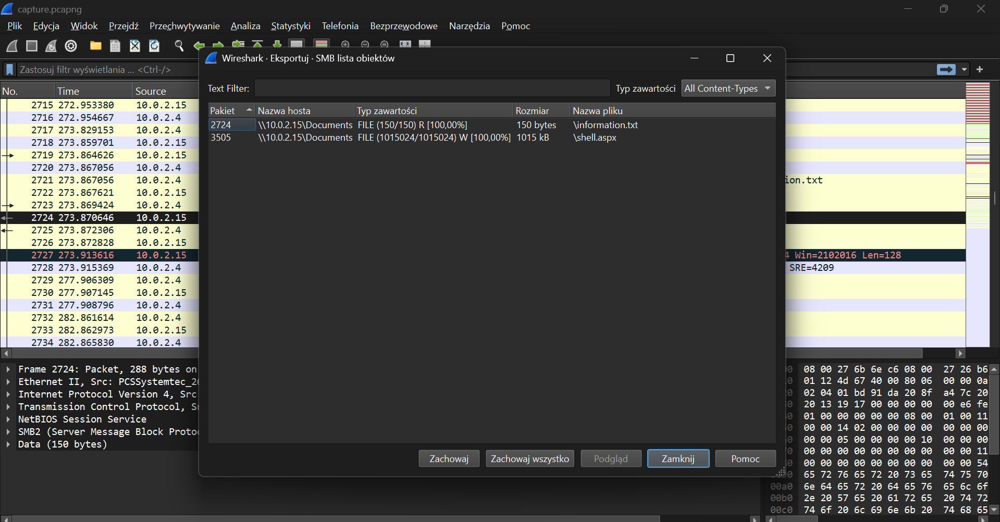

#  DFIR Case Study: Post-Exploitation IIS Analysis, Memory Forensics & AgentTesla Classification ("Lockdown" Scenario)


---

##  1. Executive Summary

This document presents a technical post-exploitation incident response and digital forensics report conducted following the detection of suspicious activity on an enterprise web server hosting **Microsoft IIS**.

The investigation encompassed full-packet network capture (`.pcap`), a raw volatile physical memory snapshot (`.mem`), and extracted disk artifacts. Findings confirm that the adversary leveraged a web application vulnerability to achieve Remote Code Execution (RCE) under the context of the IIS worker process (`w3wp.exe`), established a reverse shell connection, and deployed a persistence mechanism within the Windows Startup directory. Static code inspection combined with Threat Intelligence correlation classified the final payload as an obfuscated infostealer/remote access trojan from the **AgentTesla** family, packed with **UPX** to hinder triage.

---

##  2. Analysis Environment & Toolset

- **Network Forensics:** Wireshark
- **Memory Forensics:** Volatility 3 Framework (WSL2 Ubuntu environment)
- **Static Malware Analysis:** Pestudio, PE-bear, FLOSS, UPX, `strings`, `sha256sum` (FLARE VM / Linux)
- **Threat Intelligence & Sandboxing:** VirusTotal, MITRE ATT&CK Framework

---

##  3. MITRE ATT&CK Mapping

| Tactic | Technique | ID | Observed Incident Activity |
| :--- | :--- | :--- | :--- |
| **Initial Access / Execution** | Exploit Public-Facing Application | `T1190` | Exploitation of the public web app yielding execution via `w3wp.exe`. |
| **Persistence** | Boot or Logon Autostart Execution: Registry Run Keys / Startup Folder | `T1547.001` | Placement of the `updatenow.exe` implant inside the global `StartUp` folder. |
| **Defense Evasion** | Obfuscated Files or Information: Software Packing | `T1027.002` | Executable compression with `UPX` to conceal strings and the Import Address Table (IAT). |
| **Command and Control** | Application Layer Protocol: Web Protocols | `T1071.001` | Periodic outbound beaconing to an external C2 FQDN. |

---

##  4. Step-by-Step Investigation

### Phase I: Network Forensics (PCAP)

Initial triage focused on captured network traffic in **Wireshark** to pinpoint the entry vector, scanning behavior, and staged secondary payloads.

- **Suspicious Traffic & Addressing:**
  - Attacker IP / Attack Origin: `10.0.2.4`
  - Target Service Port: `4443`
- **Application-Layer Artifact Reconstruction:**
  Leveraging `File -> Export Objects -> HTTP` and display filters (`http.request.method == "GET"`), the initial stager was identified:
  - Downloaded Payload: `shell.aspx`



---

### Phase II: Volatile Memory Forensics (Volatility 3)

To assess machine state at the moment of capture, the raw memory dump `memdump.mem` was evaluated using Volatility 3.

#### 1. Kernel Architecture & Base Identification (Q6)
The kernel symbol profile and base virtual address for `ntoskrnl.exe` were extracted via `windows.info`:

```bash
vol -f memdump.mem windows.info
```

- **Finding (Q6 – Kernel Base Address):** `0xf80079213000`

#### 2. Process Tree Reconstruction & IIS Anomaly Detection (Q7 & Q8)
`windows.pstree` and `windows.cmdline` plugins were executed to audit parent-child process lineage (PPID -> PID):

```bash
vol -f memdump.mem windows.pstree
vol -f memdump.mem windows.cmdline | grep -i "\.exe"
```

Under the IIS service branch (`svchost.exe -k iissvcs`, PID: `2452`), worker process **`w3wp.exe`** (PID: **`4332`**) spawned an anomalous child binary outside the standard IIS execution stack:

```text
**   2452  628   svchost.exe   ... -k iissvcs
***  4332  2452  w3wp.exe      ... \Windows\System32\inetsrv\w3wp.exe
****  900  4332  updatenow.exe ... C:\ProgramData\Microsoft\Windows\Start Menu\Programs\StartUp\updatenow.exe
```

- **Finding (Q7 – Implant Full On-Disk Path):** `C:\ProgramData\Microsoft\Windows\Start Menu\Programs\StartUp\updatenow.exe`
- **Finding (Q8 – Parent Process Handling Connection & Its PID):** `w3wp.exe, 4332` (Implant PID: `900`)

---

### Phase III: Static Malware Analysis & Threat Intelligence

The binary mapped to PID `900` was dumped directly from memory address space for local triage:

```bash
vol -f memdump.mem windows.dumpfiles --pid 900
sha256sum updatenow.exe
```

#### 1. Packing & Anti-Analysis Inspection (Q9)
PE header parsing with **Pestudio** and **PE-bear** highlighted high section entropy and standard indicators of executable compression designed to defeat static disassembly:

- **Finding (Q9 – Obfuscation Packer):** `UPX`

#### 2. Threat Intelligence Correlation & C2 Infrastructure (Q10 & Q11)
The extracted cryptographic hash was queried against sandbox sandboxes and the **VirusTotal** threat database:

- **Implant SHA256:** `c25a6673a24d169de1bb399d226c12cdc666e0fa534149fc9fa7896ee61d406f`
- **Finding (Q10 – Contacted C2 FQDN):** `cp8nl.hyperhost.ua`
- **Finding (Q11 – Malware Family Classification):** `AgentTesla`

---

##  5. Indicators of Compromise (IoCs)

| IoC Type | Value | Context / Notes |
| :--- | :--- | :--- |
| **File Path** | `C:\ProgramData\Microsoft\Windows\Start Menu\Programs\StartUp\updatenow.exe` | Startup directory placement for user logon persistence |
| **Parent Process** | `w3wp.exe` (PID: `4332`) | Exploited IIS worker process used to spawn malware |
| **SHA256** | `c25a6673a24d169de1bb399d226c12cdc666e0fa534149fc9fa7896ee61d406f` | Dumped executable hash for `updatenow.exe` |
| **Domain (FQDN)** | `cp8nl.hyperhost.ua` | Command and Control (C2) callback infrastructure |
| **IPv4 Address** | `10.0.2.4` | Ingress traffic source identified in network captures |

---

##  6. Remediation & Hardening Recommendations

1. **Host Isolation & Persistence Removal:** Immediately quarantine the host from the internal network segment. Terminate the execution hierarchy `w3wp.exe` (PID 4332) -> `updatenow.exe` (PID 900) and purge the persistence artifact from `C:\ProgramData\Microsoft\Windows\Start Menu\Programs\StartUp\`.
2. **Network Defenses (Firewall / DNS Sinkholing):** Block outbound traffic destined for `cp8nl.hyperhost.ua` and associated infrastructure at boundary firewalls.
3. **IIS Web Server Hardening:**
   - Audit IIS application pools and virtual web directories for unauthorized web shells (`.aspx`, `.ashx`).
   - Implement **Attack Surface Reduction (ASR)** rules and monitor **Sysmon Event ID 1** for unusual `w3wp.exe` sub-process creation (e.g., `cmd.exe`, `powershell.exe`, or binaries situated inside `ProgramData` / user profile directories).
4. **Credential Invalidation:** Given that **AgentTesla** harvests credentials across installed browsers, mail clients, and system memory, enforce domain-wide credential resets and session revoking for all accounts that authenticated to the asset.

---

##  Troubleshooting & Lessons Learned

1. **WSL2 Virtual Environment & Path Translation:**
   - *Problem:* Calling Linux tools directly against raw Windows file paths (`C:\Users\...` containing backslashes `\`) failed with `File does not exist` errors due to Bash escape character interpretation.
   - *Resolution:* Corrected path syntax to reference the WSL VHD mount point (`/mnt/c/Users/.../memdump.mem`) and migrated memory images directly into the native Linux root filesystem (`~/`) to remove cross-filesystem I/O bottlenecks.

2. **Python Packaging Constraints (PEP 668) & Missing Build Dependencies:**
   - *Problem:* PEP 668 system-package protections prevented global package installation (`externally-managed-environment`), while building `yara-python` failed due to absent C compiler dependencies (`gcc`).
   - *Resolution:* Utilized the `--break-system-packages` override flag within the isolated lab container and proceeded with core analysis plugins (`pslist`, `pstree`, `windows.info`) that operate without native compilation dependencies.

3. **Packer Obfuscation Concealing Static Telemetry (Defense Evasion):**
   - *Problem:* Direct string dumping via `floss` and `strings` on the dropped artifact failed to expose plain-text C2 domains or clear-text configuration blocks.
   - *Resolution:* Header inspection confirmed UPX stub packing. Rather than relying on static uncompressed strings alone, the file's SHA256 digest was pivoted against curated Threat Intelligence feeds, uncovering dynamic execution profiles and confirmed C2 destinations.

---

##  Key Takeaways

- **Process Lineage as Primary Detection Vector:** Memory analysis demonstrates that core web processes (`w3wp.exe`) should never spawn binaries located in system autostart locations (`StartUp`). This parent-child discrepancy serves as an immediate high-fidelity IOC for EDR and SIEM detection engineering.
- **Multilayered Telemetry Fusion:** Neither network captures nor memory forensics alone provide a complete picture of an intrusion. Correlating ingress network traffic (initial staging), memory forensics (parentage and execution flow), and static analysis (threat attribution) is required to reconstruct the complete Cyber Kill Chain.

---

##  7. References & Documentation

- **MITRE ATT&CK – Agent Tesla (S0331):** https://attack.mitre.org/software/S0331/
- **MITRE ATT&CK – Boot or Logon Autostart Execution (T1547.001):** https://attack.mitre.org/techniques/T1547/001/
- **Volatility 3 Official Documentation:** https://volatility3.readthedocs.io/
- **Wireshark User's Guide – Exporting Objects:** https://www.wireshark.org/docs/wsug_html_chunked/ChIOExportSection.html
